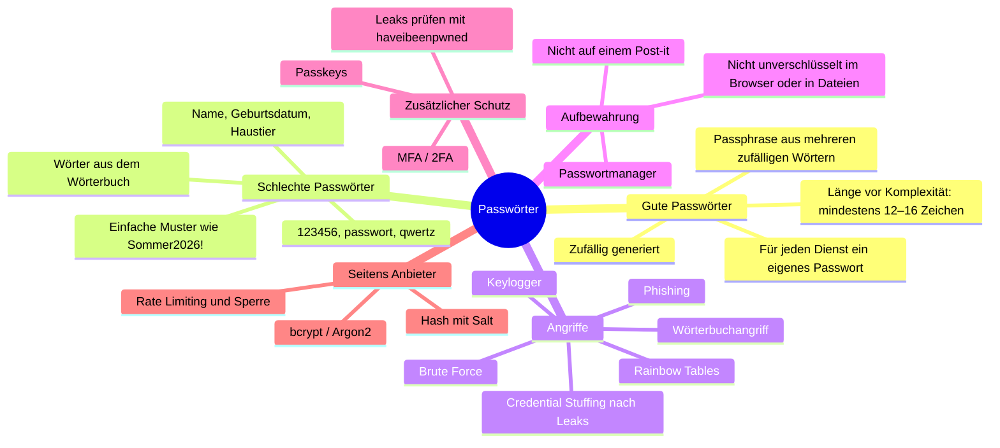

# Diskussion Passwörter – MindMap

> ✏️ **TODO**: Diese Aufgabe ist ein **Austausch in der Gruppe**. Ergänze die MindMap mit den Punkten aus eurer Diskussion bzw. ersetze sie durch einen Screenshot eurer eigenen MindMap.

## Wichtigste Erkenntnisse
- **Länge schlägt Komplexität.** Jedes zusätzliche Zeichen vervielfacht die Anzahl Kombinationen. Ein Beispiel: «Kaffee-Tram-Gletscher-Velo» ist sicherer und leichter zu merken als «K#7z!».
- **Wiederverwendung ist das grösste Risiko.** Nach einem Leak probieren Angreifer die Kombination aus E-Mail und Passwort automatisch bei anderen Diensten aus (Credential Stuffing).
- Häufige Zwangswechsel bringen wenig. Das NIST empfiehlt heute, Passwörter nur bei einem Verdacht auf Kompromittierung zu ändern.
- Die beste Lösung ist ein **Passwortmanager + MFA**, langfristig **Passkeys**.

## Meine Meinung / Diskussionspunkte aus der Gruppe
✏️ **TODO**
