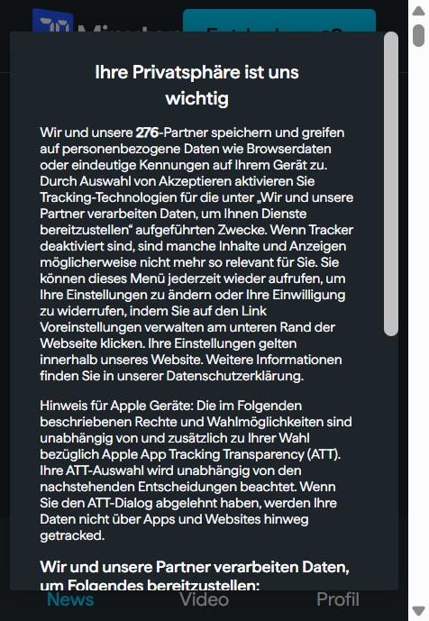

# Webseite verwendet Cookies

## Was ist ein Cookie?
Ein Cookie ist eine kleine Textdatei bzw. ein Name-Wert-Paar, das ein Webserver im Browser speichert. Der Browser sendet es bei jeder weiteren Anfrage an dieselbe Domain automatisch mit. HTTP ist **zustandslos**. Erst Cookies ermöglichen es, sich zu «merken», wer man ist, zum Beispiel für ein Login oder einen Warenkorb.

## Funktionsweise
```
1. Browser  → GET /login                       → Server
2. Browser  ← 200 OK  Set-Cookie: session=ab12; HttpOnly; Secure  ← Server
3. Browser  → GET /konto   Cookie: session=ab12 → Server   (Server erkennt den Benutzer)
```
Wichtige Attribute: `Expires`/`Max-Age` (Lebensdauer), `Domain`, `Path`, `Secure` (nur über HTTPS), `HttpOnly` (kein Zugriff per JavaScript), `SameSite` (Schutz vor CSRF).

## Arten von Cookies
| Art | Beschreibung | Einwilligung nötig? |
|---|---|---|
| **Session-Cookie** | Wird beim Schliessen des Browsers gelöscht | – |
| **Persistentes Cookie** | Hat ein Ablaufdatum und bleibt bis dahin gespeichert | – |
| **First-Party** | Stammt von der besuchten Domain | – |
| **Third-Party** | Stammt von einer fremden Domain (z. B. Werbenetzwerk). Ermöglicht seitenübergreifendes Tracking. | ja |
| **Notwendig / technisch** | Login, Warenkorb, Spracheinstellung, Cookie-Einwilligung | nein |
| **Präferenzen / Funktional** | Komfortfunktionen | in der EU in der Regel ja |
| **Statistik / Analyse** | z. B. Google Analytics | ja (EU) |
| **Marketing / Tracking** | Personalisierte Werbung, Profilbildung | ja |

## Wieso braucht es Cookie-Banner?
- **EU**: Die ePrivacy-Richtlinie und die DSGVO verlangen eine **vorgängige, informierte und freiwillige Einwilligung (Opt-in)** für alle Cookies, die nicht technisch notwendig sind. «Ablehnen» muss genauso einfach sein wie «Akzeptieren».
- **Schweiz**: Art. 45c FMG und das DSG verlangen grundsätzlich nur eine **Information** und eine Möglichkeit zum Widerspruch (Opt-out). Schweizer Websites, die sich an EU-Besucher richten, müssen jedoch die DSGVO einhalten. Deshalb haben die meisten Schweizer Websites ebenfalls Banner.
- **Sinn und Zweck**: Transparenz und Selbstbestimmung. Der Nutzer soll entscheiden können, ob sein Surfverhalten verfolgt wird.

## Problematik
- «Dark Patterns»: Der Akzeptieren-Knopf ist farbig hervorgehoben, das Ablehnen ist versteckt.
- Banner-Müdigkeit führt dazu, dass Nutzer alles akzeptieren.
- Auch ohne Cookies wird getrackt: Browser-Fingerprinting, Tracking-Pixel, Local Storage.

## Selbstschutz
- In Banners «Nur notwendige» wählen
- Drittanbieter-Cookies im Browser blockieren, Tracking-Schutz aktivieren (Firefox, Brave)
- Erweiterungen wie uBlock Origin
- Cookies regelmässig löschen oder den privaten Modus verwenden

## Praxis: Cookies auf 20min.ch untersucht (05.11.2026)
Vorgehen: 20min.ch in einem Browser aufgerufen und den Cookie-Banner **nicht** angeklickt, also **keine Auswahl getroffen**. Danach mit den Entwicklertools (F12 → Konsole: `document.cookie`, `performance.getEntriesByType('resource')`) ausgewertet, was die Seite schon geladen und gespeichert hat.



### Ergebnis
| | Anzahl |
|---|---|
| Partner laut Cookie-Banner | **276** |
| Cookies (per JavaScript sichtbar, ohne HttpOnly) | **16** |
| Einträge im Local Storage | 8 |
| Netzwerk-Anfragen beim Laden | 160 |
| Kontaktierte Domains | 31, davon **25 Drittanbieter** |

**Gefundene Tracking-Cookies (Auswahl):**
| Cookie | Anbieter | Zweck |
|---|---|---|
| `_ga`, `_ga_…`, `_gcl_au`, `FPLC`, `FPGSID` | Google Analytics / Google Ads | Besucher wiedererkennen, Statistik, Werbe-Conversions |
| `_fbp` | Meta (Facebook) | Werbe-Tracking, Facebook-Pixel |
| `_ttp`, `ttcsid…`, `_tt_enable_cookie` | TikTok | Werbe-Tracking, TikTok-Pixel |
| `_vwo_uuid_v2` | VWO | A/B-Tests |
| `_k5a` | Kilkaya | Reichweitenmessung |
| `OptanonConsent` | OneTrust | Speichert die Cookie-Einwilligung |
| `FCCDCF` | Google Funding Choices | Einwilligungsstatus für Werbung |

**Drittanbieter-Domains (Auswahl):** googletagmanager.com, doubleclick.net (Google-Werbung), connect.facebook.net, analytics.tiktok.com, scorecardresearch.com, brandmetrics.com, adtrafficquality.google, cookielaw.org / onetrust.com.

### Erkenntnis
Obwohl ich **nichts angeklickt** hatte, waren schon Tracking-Cookies von Google, Meta und TikTok gesetzt. Im `OptanonConsent`-Cookie sind alle Kategorien vorab als **erlaubt** markiert (`C0001:1, C0002:1, C0003:1, C0004:1, C0005:1`).

Das passt zum **Schweizer Opt-out-Prinzip** (siehe oben): Die Seite informiert und lässt widersprechen, aktiviert aber standardmässig alles. In der EU wäre das nach DSGVO und ePrivacy unzulässig, dort müssten Marketing-Cookies erst **nach** einer Zustimmung gesetzt werden (Opt-in). Wer das nicht will, muss im Banner aktiv «Ablehnen» bzw. «Einstellungen» wählen oder Drittanbieter-Cookies im Browser blockieren.

> Hinweis: Das Ergebnis kann je nach Browser, Standort und vorherigen Besuchen leicht abweichen.
