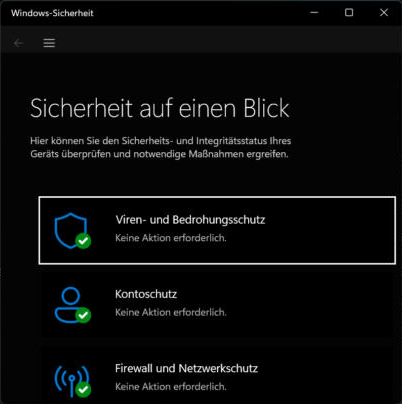
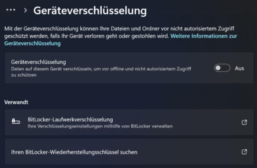
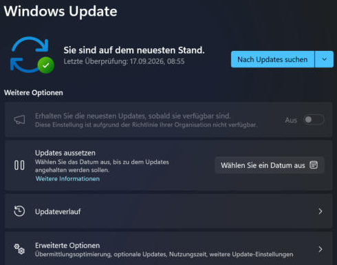
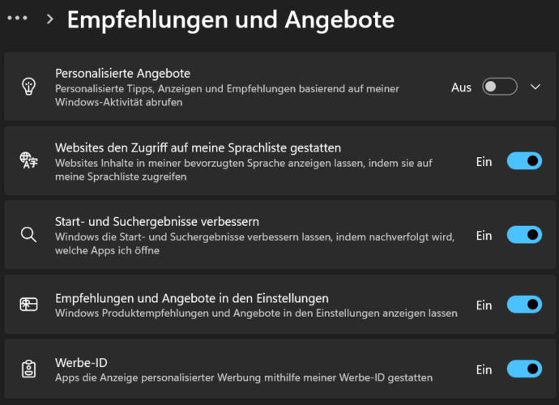
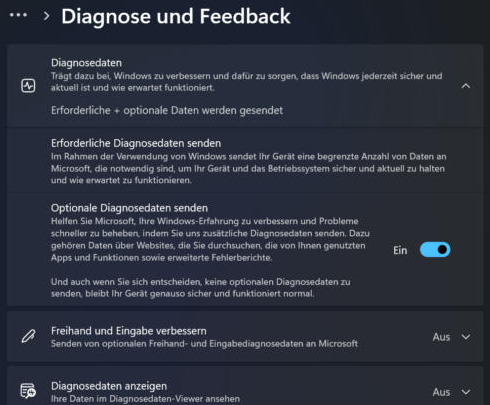
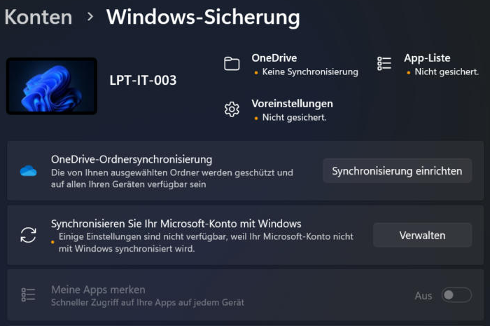

# Checklisten Datenschutzmassnahmen – eigene Infrastruktur

Basierend auf den Empfehlungen von EDÖB, BACS und «S-U-P-E-R.ch». Hake ab, was bei dir erfüllt ist, und notiere, was du geändert hast.

## Smartphone
- [ ] Bildschirmsperre mit PIN (mindestens 6 Ziffern) oder Biometrie
- [ ] Betriebssystem und Apps sind aktuell, automatische Updates aktiv
- [ ] App-Berechtigungen geprüft (Standort, Kamera, Mikrofon, Kontakte)
- [ ] Werbe-ID zurückgesetzt bzw. deaktiviert (iOS: «Apps erlauben, Tracking anzufordern» aus; Android: Werbe-ID löschen)
- [ ] Ortungsdienste nur «beim Verwenden der App»
- [ ] «Mein Gerät finden» aktiv und Fernlöschung möglich
- [ ] Gerät verschlüsselt (bei aktuellem iOS/Android standardmässig)
- [ ] Nicht benötigte Apps gelöscht
- [ ] Backup eingerichtet

## Computer (Windows)
Geprüft am 05.11.2026 auf meinem Laptop (Windows 11 Education, von der Organisation verwaltet).

- [x] Benutzerkonto mit Passwort / Windows Hello (PIN und Gesichtserkennung verfügbar, teils von der Organisation verwaltet)
- [x] Windows Update aktiv: «Sie sind auf dem neuesten Stand». ⚠️ Die letzte Überprüfung war aber am **17.09.2026**, also vor 7 Wochen → manuell «Nach Updates suchen».
- [x] Microsoft Defender und Firewall aktiv: Viren- und Bedrohungsschutz, Kontoschutz, Firewall: «Keine Aktion erforderlich»
- [ ] ❌ **Geräteverschlüsselung: Aus**. Bei Verlust oder Diebstahl des Laptops wären alle Daten lesbar.
- [ ] ⚠️ Datenschutzeinstellungen: **Optionale Diagnosedaten: Ein**, **Werbe-ID: Ein**, «Start- und Suchergebnisse verbessern» (App-Tracking): Ein. Positiv: «Personalisierte Angebote» ist aus.
- [ ] Alltags-Arbeit nicht mit dem Administratorkonto (zu prüfen)
- [ ] ❌ **Backup: keines eingerichtet**. Windows-Sicherung zeigt OneDrive «Keine Synchronisierung», App-Liste und Voreinstellungen «Nicht gesichert».

| Windows-Sicherheit | Geräteverschlüsselung |
|---|---|
|  |  |

| Windows Update | Werbe-ID |
|---|---|
|  |  |

| Diagnosedaten | Windows-Sicherung |
|---|---|
|  |  |

## Browser
- [ ] Drittanbieter-Cookies blockiert, Tracking-Schutz «Streng»
- [ ] Werbeblocker (uBlock Origin)
- [ ] Passwörter in einem Passwortmanager statt im Browser
- [ ] Datenschutzfreundliche Suchmaschine geprüft
- [ ] Erweiterungen auf das Nötigste reduziert

## Online-Konten / Social Media
- [ ] Profile auf «privat» bzw. nur für Freunde sichtbar
- [ ] MFA bei E-Mail, Social Media, Banking und Cloud aktiv
- [ ] Unterschiedliche, starke Passwörter
- [ ] Verknüpfte Apps und Logins («Mit Google anmelden») geprüft
- [ ] Mein E-Mail-Konto bei haveibeenpwned.com geprüft
- [ ] Personalisierte Werbung deaktiviert (Google «Mein Werbecenter», Meta-Werbeeinstellungen)

## Heimnetz
- [ ] Router-Adminpasswort geändert
- [ ] WLAN mit WPA2/WPA3 und starkem Passwort
- [ ] Firmware des Routers aktuell
- [ ] WPS deaktiviert
- [ ] Gäste-WLAN für Besuch und IoT-Geräte

## Meine Änderungen
| Gerät / Dienst | Was war nicht OK? | Was habe ich geändert? |
|---|---|---|
| Windows: Werbe-ID | Ein | ✏️ ausschalten (Einstellungen → Datenschutz und Sicherheit → Empfehlungen und Angebote) |
| Windows: Optionale Diagnosedaten | Ein | ✏️ ausschalten (Datenschutz und Sicherheit → Diagnose und Feedback) |
| Windows: Geräteverschlüsselung | Aus | ✏️ einschalten bzw. bei der IT nachfragen. **Wiederherstellungsschlüssel sichern!** |
| Windows: Backup | keines | ✏️ siehe [Windows Backup](../LB2/07_Windows_Backup.md) |
| Windows Update | letzte Prüfung vor 7 Wochen | ✏️ «Nach Updates suchen» klicken |
